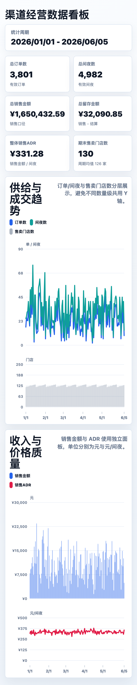
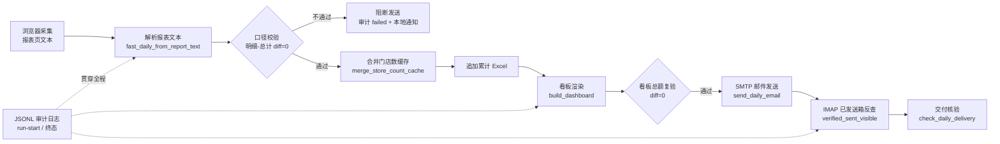

# 酒店渠道日报自动化流水线

[中文](README.md) | [English](README_EN.md)

[](https://www.python.org/)
[](LICENSE)
[](#quick-start)

**酒店多渠道日报自动化流水线：报表采集 → 指标口径校验 → 看板渲染 → 邮件推送 → 交付核验（IMAP 已发送反查）→ 全程 JSONL 审计。**

面向酒店多渠道分销的每日经营数据：从后台报表页面取数，经「明细-总计 diff=0」口径校验后渲染移动端看板 PNG 并邮件推送，用「SMTP 发送 + IMAP 已发送箱反查」把邮件送达从玄学变成可断言的事实，全程 JSONL 审计留痕。仓库内置虚构 mock 数据，clone 后一键跑通，无需任何真实凭据或后台访问。

> 下图为虚构 mock 数据渲染的样例看板（真实经营数据不入库）：



## 背景

多渠道酒店分销的每日日报，人工做有四个痛点：

1. **渠道多、口径易错**：十几个渠道的明细行汇总，容易与后台总计行对不上；
2. **人工盯发**：每天手工截图、贴邮件、点发送，重复且占时间；
3. **送达无凭据**：SMTP 返回成功 ≠ 邮件真的在收件人可见的已发送箱里；
4. **出问题无迹可循**：没发出去、发错了、数不对，事后查不到现场。

本仓库把整条链路脚本化，并给每个环节加了校验与留痕。

## 架构



审计不是最后一步，而是贯穿全程：任务开始前写 run-start 行，每个关键节点结束写终态（`verified_sent_visible` / `failed` / `blocked`）。渲染在发邮件之前——邮件正文嵌的就是渲染出来的 PNG。

## 核心特性

- **指标口径与数据契约**：口径定义集中在 [docs/data-contract](skills/dashboard-builder/references/data-contract.md)（售卖门店数、ADR、有产率等），看板渲染前强制「明细汇总 == 后台总计行」校验，差异非零即阻断，杜绝口径漂移。
- **异常预警**：校验失败即阻断发送并触发本地通知；审计状态机覆盖 `failed` / `blocked` / `partial_smtp_accepted_but_sent_folder_unverified` 等中间态，失败一定有现场。
- **交付核验（verified_sent_visible）**：SMTP accepted 只是中间态，唯一成功口径是「同一封 MIME 追加进 IMAP 已发送箱 + 重开邮箱反查命中主题与收件人」。详见 [docs/delivery-verification.md](docs/delivery-verification.md)。
- **Agent/Skill 架构**：浏览器取数由 Agent 会话执行（见各 `skills/*/SKILL.md` 与流程文档），解析、校验、渲染、发送全部脚本化——Agent 只做浏览器里「读数」这一步，其余交给确定性代码，职责边界清晰。
- **全链路 JSONL 审计**：运行起止、状态、耗时、错误信息逐条落盘，事后可按日期复核任意一天的交付状态（退出码 0/2）。
- **节假日跳过**：内置 2026 年法定节假日与调休表（来源：国办公开文件），非工作日自动跳过发送。
- **防猜数纪律**：门店数等关键字段只读报表总计行，禁止用渠道明细最大值/求和/均值替代，读不到就报错，不猜。

## Quick Start

```bash
git clone https://github.com/marqosjiang-gif/channel-daily-report-pipeline.git
cd channel-daily-report-pipeline

python3 -m venv .venv && source .venv/bin/activate
pip install -r requirements.txt

python3 scripts/generate_mock_data.py   # 生成虚构 mock 数据（可复现，seed=42）
python3 scripts/run_demo.py             # 一键端到端：解析→校验→缓存合并→累计Excel→看板→diff=0 报告
```

无 node/playwright 时自动降级为仅生成 HTML 看板（校验逻辑不受影响）；有 node + playwright 时额外输出移动端 PNG。

样例看板交互版可直接在浏览器打开：[data/mock/sample_dashboard/dashboard-sample.html](data/mock/sample_dashboard/dashboard-sample.html)。

### 发送真实邮件（可选）

```bash
cp .env.example .env                    # 填入 SMTP/IMAP 凭据与收件人
cp config/smtp_config.example.json config/smtp_config.json

export RECIPIENT_EMAIL=ops@example.com
python3 skills/dashboard-builder/scripts/fast_daily_from_report_text.py \
  --date 2026-06-05 \
  --report-text data/report_text/channel_report_text_20260605.txt \
  --send-email
```

## 环境变量

| 变量 | 必填 | 说明 |
|---|---|---|
| `RECIPIENT_EMAIL` | 发邮件时必填 | 日报收件人 |
| `SMTP_USER` / `SMTP_PASSWORD` | 发邮件时必填 | SMTP/IMAP 凭据（企业邮箱客户端专用密码），运行时注入 config，不落盘 |
| `EMAIL_GREETING` | 否 | 邮件称呼，默认「您好」 |
| `CHANNEL_REPORT_URL` | 浏览器采集时必填 | 渠道后台报表中心地址（仅 Agent 会话使用） |
| `NODE_BIN` / `NODE_PATH` | 否 | PNG 渲染用的 node 与 playwright 路径 |
| `CHANNEL_EXCEL_PATH` | 否 | 指定后台导出 Excel 路径 |

## 目录结构

```
skills/
├── dashboard-builder/       # 看板渲染 + 邮件发送 + 交付核验 + 快速日更流水线
├── store-count-collector/   # 售卖门店数逐日取数与缓存合并
├── daily-report-runner/     # 按调度运行的日报工作流（含节假日跳过）
└── channel-store-count/     # 渠道后台总计门店数取数
scripts/
├── generate_mock_data.py    # 虚构 mock 数据生成器（seed=42 可复现）
└── run_demo.py              # 一键端到端演示
data/mock/                   # 提交在仓库的 mock fixtures
docs/                        # 数据契约 / 交付核验机制说明
deploy/vercel-static/        # 静态看板 Vercel 部署辅助
```

## Limitations（诚实声明）

- **浏览器采集不在本仓库内**：渠道后台取数依赖 Agent 的内置浏览器会话（登录态在用户本地），本仓库不含通用爬虫；`SKILL.md` 与流程文档描述了完整的取数规则与异常处理。
- **mock 数据均为虚构**：仓库内所有数字为演示用途随机生成，与任何真实经营数据无关；门店数量级刻意与真实规模错开。
- **节假日表需按年更新**：`daily-report-runner` 内置 2026 年表，其他年份按普通周内工作日处理并在审计日志注明。
- **SMTP 配置以你的邮箱供应商为准**：已发送箱名称（默认 `Sent Messages`）、端口与认证方式可能不同。

## License

[MIT](LICENSE)
