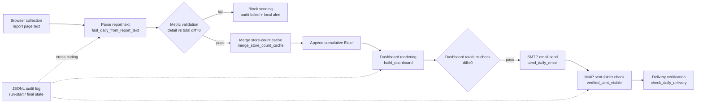

# Hotel Channel Daily Report Pipeline

[中文](README.md) | [English](README_EN.md)

[](https://www.python.org/)
[](LICENSE)
[](#quick-start)

**Hotel multi-channel daily report automation pipeline: report collection → metric validation → dashboard rendering → email delivery → delivery verification (IMAP sent-folder check) → full-chain JSONL audit.**

Daily operations data for hotel multi-channel distribution: numbers are collected from the backend report page, validated with a strict "detail rows == total row (diff must be 0)" data contract, rendered into a mobile dashboard PNG, and pushed via email. A strict "SMTP send + IMAP sent-folder verification" turns "was the email actually sent?" from a guess into an assertable fact, with JSONL audit logs across the whole chain. The repo ships with fictional mock data — clone and run in one command, no real credentials or backend access required.

> Sample dashboard rendered from fictional mock data (no real business data in this repo):


## Background

Manually producing a daily multi-channel hotel report hurts in four ways:

1. **Many channels, error-prone metrics**: aggregating a dozen channel rows easily drifts from the backend total row;
2. **Manual routine**: daily screenshot / paste / send is repetitive and time-consuming;
3. **No delivery proof**: SMTP success ≠ the message is visible in the sent folder;
4. **No post-mortem trail**: when something goes wrong, there is no record of what happened.

This repo scripts the whole chain and adds validation and audit trails to every step.

## Architecture



Audit is not the last step — it is cross-cutting: a run-start line is written before business work begins, and a final state (`verified_sent_visible` / `failed` / `blocked`) is written at every key checkpoint. Rendering happens before emailing — the email body embeds the rendered PNG.

## Key Features

- **Metric contract & validation**: metric definitions live in [docs/data-contract](skills/dashboard-builder/references/data-contract.md) (selling stores, ADR, productive rate, etc.). Before rendering, "sum of detail rows == backend total row" is enforced; any non-zero diff blocks the run.
- **Failure alerting**: failed validation blocks sending and triggers a local notification; the audit state machine covers `failed` / `blocked` / `partial_smtp_accepted_but_sent_folder_unverified`.
- **Delivery verification (verified_sent_visible)**: SMTP acceptance is only an intermediate state. The only success status is "the same MIME message appended to the IMAP sent folder + reopened mailbox lookup matches subject and recipient". See [docs/delivery-verification.md](docs/delivery-verification.md).
- **Agent/Skill architecture**: browser collection is performed by an agent session (see `skills/*/SKILL.md` and flow docs); parsing, validation, rendering and sending are fully scripted — the agent only reads numbers in the browser, everything else is deterministic code.
- **Full-chain JSONL audit**: run start/end, status, elapsed time and errors are logged; the delivery status of any past day can be re-checked by date (exit code 0/2).
- **Holiday skip**: built-in 2026 China public holiday & makeup-workday table (from official government announcements); sends are skipped on non-workdays.
- **No-guessing discipline**: key fields such as selling stores are read only from the report total row — never max/sum/average of channel rows; if unreadable, fail loudly instead of guessing.

## Quick Start

```bash
git clone https://github.com/marqosjiang-gif/channel-daily-report-pipeline.git
cd channel-daily-report-pipeline

python3 -m venv .venv && source .venv/bin/activate
pip install -r requirements.txt

python3 scripts/generate_mock_data.py   # generate reproducible fictional mock data (seed=42)
python3 scripts/run_demo.py             # one command end-to-end: parse → validate → merge → Excel → dashboard → diff=0 report
```

Without node/playwright the demo degrades to HTML-only output (validation logic unaffected); with node + playwright it also renders the mobile PNG.

An interactive sample dashboard can be opened directly in a browser: [data/mock/sample_dashboard/dashboard-sample.html](data/mock/sample_dashboard/dashboard-sample.html).

### Sending a real email (optional)

```bash
cp .env.example .env                    # fill in SMTP/IMAP credentials and recipient
cp config/smtp_config.example.json config/smtp_config.json

export RECIPIENT_EMAIL=ops@example.com
python3 skills/dashboard-builder/scripts/fast_daily_from_report_text.py \
  --date 2026-06-05 \
  --report-text data/report_text/channel_report_text_20260605.txt \
  --send-email
```

## Environment Variables

| Variable | Required | Description |
|---|---|---|
| `RECIPIENT_EMAIL` | required for sending | Report recipient |
| `SMTP_USER` / `SMTP_PASSWORD` | required for sending | SMTP/IMAP credentials (mail-provider client secret), injected at runtime, never committed |
| `EMAIL_GREETING` | optional | Email greeting, defaults to「您好」 |
| `CHANNEL_REPORT_URL` | required for browser collection | Channel-backend report center URL (agent session only) |
| `NODE_BIN` / `NODE_PATH` | optional | node and playwright paths for PNG rendering |
| `CHANNEL_EXCEL_PATH` | optional | Explicit path to the backend-exported Excel |

## Repository Layout

```
skills/
├── dashboard-builder/       # Dashboard rendering + email send + delivery check + fast daily pipeline
├── store-count-collector/   # Daily selling-store-count collection and cache merge
├── daily-report-runner/     # Scheduled daily report workflow (with holiday skip)
└── channel-store-count/     # Backend total store-count collection
scripts/
├── generate_mock_data.py    # Fictional mock data generator (reproducible, seed=42)
└── run_demo.py              # One-command end-to-end demo
data/mock/                   # Mock fixtures committed to the repo
docs/                        # Data contract / delivery verification docs
deploy/vercel-static/        # Static dashboard Vercel deploy helper
```

## Limitations

- **Browser collection is not part of this repo**: backend data collection relies on an agent's in-app browser session (login state lives on the user's machine); no general-purpose scraper is included. The `SKILL.md` and flow docs describe the full collection rules and error handling.
- **All mock data is fictional**: every number in the repo is randomly generated for demo purposes and unrelated to any real business data; the store-count magnitude is deliberately kept apart from real-world scale.
- **Holiday table is year-bound**: `daily-report-runner` embeds the 2026 table; other years fall back to regular weekdays and note so in the audit log.
- **SMTP settings depend on your mail provider**: sent-folder name (default `Sent Messages`), ports and auth may differ.

## License

[MIT](LICENSE)
